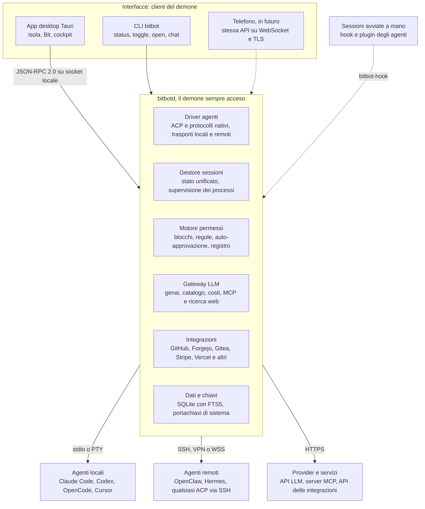

# BitBot — Piano di progetto

Ultimo aggiornamento: 20 ottobre 2026.

> Documento di riferimento del progetto, per persone e agenti. La fase in corso è indicata in `AGENTS.md`.

## Sintesi

BitBot è un companion desktop che riunisce gli agenti di coding dell'utente (Claude Code, Codex, OpenCode, Cursor, OpenClaw, Hermes) e una chat con qualsiasi LLM. Mostra con un'occhiata cosa stanno facendo, senza aprire niente: è questo il momento magico da cui dipende tutto il resto.

A differenza di Coucou, che si aggancia agli agenti avviati nel terminale tramite hook, BitBot li pilota. L'utente sceglie agente, modello, effort, progetto e sessione; BitBot avvia, riprende e supervisiona. L'osservazione delle sessioni avviate a mano arriva in una fase successiva.

Proposta di identità: il prodotto si chiama BitBot, il personaggio pixel-art che lo rappresenta si chiama Bit.

Principi guida:

- **Uno stato unificato per tutti gli agenti.** Ogni driver traduce gli eventi del suo agente nello stesso modello (al lavoro, in attesa, finito, errore). La vista compatta vale quanto questa traduzione.
- **Interfaccia guidata dalle capacità.** I selettori di modello ed effort nascono da ciò che l'agente dichiara, non da liste scritte a mano.
- **Il core vive a parte.** Un demone tiene in vita le sessioni anche a finestra chiusa e prepara il terreno per telefono e accesso remoto.
- **Locale e privato.** Zero telemetria, chiavi nel portachiavi del sistema, mai esposte all'interfaccia web.
- **Ogni agente con il suo login.** Le chiavi di BitBot servono alla chat e, come opzione avanzata, agli agenti che accettano provider personalizzati.
- **Bene ovunque.** macOS, Windows e Linux (X11 e Wayland) sono di prima classe, con un ripiego previsto per ogni limite di piattaforma.

## Decisioni prese

Il perimetro: uso personale ora e open source poi, quattro agenti via ACP nell'MVP, tutte le piattaforme da subito.

| Area | Decisione |
| --- | --- |
| Pubblico | Uso personale ora, poi open source con licenza MIT |
| Nome | BitBot, per evitare la collisione con la CLI `bit` di bit.dev |
| Approccio | Da zero, con Coucou solo come riferimento. BitBot pilota gli agenti; l'osservazione dei terminali arriva dopo l'MVP |
| Momento magico | Tutti gli agenti visibili con un'occhiata, senza aprire niente |
| Presenza | Isola in alto (nel notch sui Mac che lo hanno), Bit trascinabile sul desktop, cockpit con scorciatoia globale |
| Vista | Stato per sessione e approvazioni nella vista ridotta, dettaglio completo nel cockpit |
| Personaggio | Pixel-art con animazioni leggere e una modalità pro senza fronzoli; notifiche di sistema più animazione |
| Piattaforme | macOS, Windows e Linux di prima classe; app mobile più avanti |
| Stack | Tauri 2, core come demone separato dalla UI |
| Agenti | I sei richiesti più qualsiasi agente ACP configurabile a mano; rilevamento con installazione guidata |
| Integrazione agenti | Login nativo di ogni agente; ACP ovunque, protocolli nativi dove offrono di più |
| Sessioni | Native dell'agente e raggruppate per progetto; parallele con worktree opzionale; handoff tra agenti con il contesto |
| Remoto | VPN, tunnel SSH e WebSocket esposto con token |
| Modelli ed effort | Lista dinamica con preferiti e alias; livelli di effort nativi; preset che fissano agente, modello ed effort |
| Progetti | Cartelle e repo locali, aggiunti a mano o importati dalla cronologia degli agenti, più clonazione da GitHub, Forgejo e Gitea |
| Impostazioni progetto | Salvate in locale, esportabili |
| Permessi | Regole per progetto e per agente, auto-approvazione globale attivabile; worktree e modalità degli agenti, container in seguito |
| Chat | Domande rapide con allegati, contesto di progetto attivabile, MCP, ricerca web opzionale, passaggio dalla chat al task; voce e confronto tra modelli in seguito |
| Provider | Endpoint OpenAI-compatibili, Anthropic e Gemini nativi, modelli locali; Bedrock, Vertex e Azure in seguito; nessun fallback all'inizio |
| Dati | Indice SQLite locale, trascrizioni lasciate agli agenti; consumi, costi e limiti dei piani tracciati in locale |
| Chiavi e privacy | Portachiavi del sistema e variabili d'ambiente; zero telemetria |
| Integrazioni | Catalogo completo stile Coucou |
| Risorse | Sviluppatore singolo, nessuna stima di tempo: fasi con criteri di completamento, non scadenze |
| MVP | Claude Code, Codex, OpenCode e Cursor via ACP con selettori di modello, effort, progetto e sessione; chat OpenAI-compatibile più Anthropic; vista compatta con approvazioni |
| Distribuzione | GitHub Releases, interfaccia in inglese e italiano |

## Architettura

BitBot è un demone che possiede processi, chiavi e stato, più interfacce leggere che lo comandano: chiudere la finestra non ferma nulla.



Interfaccia e CLI non parlano mai direttamente con agenti o provider: chiedono al demone. Per questo le sessioni sopravvivono alla chiusura della finestra, e un domani il telefono userà la stessa API. Le linee tratteggiate indicano parti che arrivano dopo l'MVP; ogni freccia parte da chi avvia la comunicazione.

### Modello di stato unificato

Ogni driver traduce gli eventi del suo agente in questi stati. La vista ridotta mostra solo questi, con l'ultima azione accanto.

- **Avvio**: processo in partenza, inizializzazione o login in corso.
- **Al lavoro**: con l'ultima azione, il suo tipo (lettura, modifica, comando) e le righe cambiate.
- **In attesa di permesso**: una richiesta da approvare.
- **In attesa di risposta**: una domanda o un piano da approvare, come le estensioni di Cursor.
- **Finito**: turno concluso, pronta per il prossimo prompt.
- **Errore**: processo caduto, login scaduto, limite del piano raggiunto.
- **Archiviata**: fuori dalla vista ridotta, ritrovabile nel cockpit.

### Flussi principali

1. **Nuova sessione**: l'utente sceglie progetto e preset dal cockpit o dal composer rapido. Il demone crea il worktree se richiesto, avvia il driver nella cartella giusta, e la pillola compare nell'isola.
2. **Permesso**: l'agente chiede e il motore permessi decide tra blocco, regola, auto-approvazione o domanda. Se serve l'utente, la scheda compare nell'isola e Bit lo segnala; la risposta torna all'agente.
3. **Ripresa**: al riavvio il demone rilegge dall'indice le sessioni attive e le riprende con il metodo che ogni agente supporta.

## Strato agenti

Un unico client ACP pilota tutti e sei gli agenti. I driver nativi si aggiungono solo dove portano qualcosa che ACP non offre.

| Agente | Ingresso ACP | Driver nativo, quando serve | Da sapere |
| --- | --- | --- | --- |
| Claude Code | Adattatore `claude-agent-acp`, basato sul Claude Agent SDK | Terminale gestito: la CLI ufficiale in un terminale integrato, seguita tramite hook | Login: vedi sotto |
| Codex | Adattatore `codex-acp` | `codex app-server`: JSON-RPC con thread, turni, approvazioni, login e limiti del piano ChatGPT | Lo schema si esporta in JSON Schema, utile per generare i tipi Rust |
| OpenCode | `opencode acp`, nativo | `opencode serve`: HTTP con specifica OpenAPI 3.1, sessioni ed eventi SSE | BitBot può agganciarsi anche al server della TUI già aperta |
| Cursor | `agent acp`, nativo (cercare prima `cursor-agent`: il nome `agent` può collidere con altre CLI) | Non serve all'inizio | Le estensioni per domande e approvazione del piano bloccano l'agente finché BitBot non risponde |
| OpenClaw | `openclaw acp`, ponte verso un Gateway locale o remoto | Protocollo WebSocket del Gateway, per sessioni persistenti | Il ponte non usa file e terminale del client |
| Hermes | `hermes acp` | Server API compatibile OpenAI, HTTP con SSE e header di sessione | Le sessioni ACP vivono quanto il processo |

Fonti: [ACP, opzioni di sessione](https://agentclientprotocol.com/protocol/session-config-options) · [Codex app-server](https://developers.openai.com/codex/app-server) · [OpenCode server](https://opencode.ai/docs/server/) · [Cursor ACP](https://cursor.com/docs/cli/acp) · [OpenClaw ACP](https://docs.openclaw.ai/cli/acp.md) · [Hermes, integrazione programmatica](https://hermes-agent.nousresearch.com/docs/developer-guide/programmatic-integration)

### Login: ognuno il suo, con un'eccezione

BitBot non tocca le credenziali degli agenti. Rileva lo stato del login e, se manca, apre il comando nativo in un terminale integrato (per esempio `codex login`, `agent login`, `opencode auth login`).

Claude Code richiede attenzione. [Anthropic non consente](https://code.claude.com/docs/en/agent-sdk/overview) a prodotti di terze parti di offrire il login di claude.ai, compresi quelli basati sull'Agent SDK, salvo approvazione, e indica le API key. Quindi:

- **Via ACP**, Claude Code gira con API key o con un provider cloud (Bedrock, Vertex, Foundry).
- **Con l'abbonamento**, BitBot apre la CLI ufficiale `claude` nel terminale gestito, con il modello scelto passato all'avvio, e la segue tramite hook come fa Coucou.
- **Nella fase personale**, prima di usare l'abbonamento attraverso l'SDK, vanno verificati i termini di Anthropic in vigore.

### Trasporti

Ogni driver parla con il suo agente attraverso un trasporto intercambiabile:

- **Locale**: processo figlio, JSON-RPC su stdin e stdout.
- **WSL**, su Windows: lo stesso stdio attraverso `wsl.exe`, per gli agenti installati nella parte Linux.
- **SSH**: lo stdio attraverso `ssh host comando`. Qualsiasi agente ACP remoto funziona senza aprire porte; di fatto BitBot lo avvia sulla macchina remota.
- **VPN**: collegamento diretto all'indirizzo privato (Tailscale, WireGuard). BitBot usa la VPN, non la gestisce.
- **WebSocket o HTTP con token**: TLS obbligatorio, token nel portachiavi, certificato fissato al primo collegamento. Casi tipici: il Gateway OpenClaw su `wss://host:18789`, `codex app-server` in ascolto WebSocket, `opencode serve` protetto da password.

### Selettori di modello, effort e modalità

All'apertura della sessione l'agente dichiara le sue opzioni. ACP prevede categorie dedicate al modello e al livello di ragionamento, che il client cambia con `session/set_config_option`.

BitBot disegna i selettori da questa lista e mostra i livelli di effort nativi. Se un agente non dichiara opzioni, ripiega sulle vecchie modalità di sessione. Un piccolo manifest per agente corregge solo le stranezze note: nomi, valori predefiniti, alias.

### Sessioni

- **Nuova**: parte sempre con la cartella del progetto, o del suo worktree, come directory di lavoro.
- **Elenco e ripresa**: `session/list` filtrato per cartella, poi `session/resume` o `session/load`, secondo ciò che l'agente supporta.
- **Hermes e OpenClaw**: la ripresa passa dai loro identificativi nativi (chiavi di sessione del Gateway, header del server API), perché le sessioni ACP spariscono con il processo.
- **Supervisione**: il demone sorveglia i processi degli agenti; se uno cade, lo riavvia e riprende la sessione.

### Handoff tra agenti

Spostare una sessione, per esempio da Claude Code a Codex, crea un pacchetto di passaggio:

1. Un riassunto della conversazione, generato dal gateway LLM con un modello scelto dall'utente.
2. Lo stato git: branch, file modificati, modifiche non committate.
3. Piano e todo aperti, ultima richiesta dell'utente.
4. La trascrizione completa come allegato, se l'agente di destinazione accetta risorse.

La nuova sessione parte nello stesso worktree. L'indice collega le due sessioni, così la cronologia resta navigabile.

### Altri agenti e installazione

- Qualsiasi agente ACP si aggiunge a mano con nome, comando, argomenti, variabili d'ambiente e trasporto.
- Il rilevamento cerca i binari nel PATH e nei percorsi d'installazione noti, e ne legge la versione.
- L'installazione guidata usa gli installer ufficiali o i metadati di distribuzione del [registro ACP](https://agentclientprotocol.com/registry).

### Osservazione dei terminali, dopo l'MVP

Un piccolo binario `bitbot-hook` riceve gli eventi da hook e plugin degli agenti avviati a mano e li inoltra al demone. Se il demone non gira, esce subito: l'agente non viene mai bloccato, lo stesso principio di [Coucou](https://github.com/Louis-CFM/coucou). Per OpenCode basta leggere il flusso di eventi del server della TUI.

## Gateway LLM e chat generica

La chat passa da un gateway dentro il demone che parla con qualsiasi provider. La libreria Rust [`genai`](https://docs.rs/crate/genai/0.6.0/source/README.md) copre già i protocolli nativi principali, quindi il lavoro vero è il catalogo, i costi e l'esperienza.

### Provider

- **Base: `genai`.** Supporta in modo nativo OpenAI (anche Responses), Anthropic, Gemini, Ollama, Vertex, Bedrock, OpenRouter, xAI, DeepSeek, Groq e altri, con streaming e livelli di ragionamento.
- **Endpoint OpenAI-compatibili personalizzati**: qualsiasi base URL con chiave, per LM Studio, llama.cpp, vLLM, LiteLLM o gateway propri. È questo che rende vero il "tutte le API".
- **Uno strato sottile sopra la libreria**: BitBot definisce un proprio trait `Provider`. Se `genai` non basta per un caso, si scrive un adattatore a mano senza toccare il resto.
- **Ordine**: nell'MVP OpenAI-compatibile più Anthropic; poi Gemini nativo; Bedrock, Vertex e Azure in seguito, dove il lavoro vero è l'autenticazione cloud.
- **Confine netto**: la chat non riusa mai i token di login degli agenti, solo chiavi configurate in BitBot.

### Catalogo, consumi e costi

- **Modelli**: elenco letto in automatico dagli endpoint dei provider, con aggiunte e correzioni manuali.
- **Metadati e prezzi**: da [models.dev](https://github.com/anomalyco/models.dev), database aperto con capacità, finestre di contesto e costo per milione di token, cache incluse. BitBot ne tiene una copia locale aggiornata, così funziona anche offline.
- **Consumi**: ogni risposta registra token in ingresso, in uscita e in cache. Il costo si calcola in locale per provider, modello, progetto e sessione, con soglie di avviso.
- **Sessioni agente**: i consumi si leggono dove il driver li riporta.
- **Limiti dei piani**: dove l'agente li espone, come Codex tramite app-server, compaiono nella vista ridotta. Per Claude Code va trovato il meccanismo: Coucou ci arriva con un relay dedicato.

### Funzioni della chat

- **Allegati**: immagini, PDF e file di testo, inviati in forma nativa quando il catalogo dice che il modello li accetta.
- **Contesto di progetto**, attivabile: file scelti, struttura del repo, stato git, ultima sessione dell'agente.
- **Strumenti**: client MCP integrato tramite `rmcp`, l'SDK Rust ufficiale di MCP. La ricerca web usa lo strumento nativo del provider dove esiste, altrimenti un server MCP di ricerca.
- **Integrazioni come strumenti**: GitHub, Stripe e gli altri moduli espongono i loro dati alla chat. "Quante PR aspettano la mia review?" funziona senza altra configurazione.
- **Cronologia**: in SQLite, con ricerca testuale ed esportazione in Markdown.

### Dalla chat al task

Un pulsante "Fallo" trasforma la conversazione in una sessione agente:

1. L'utente sceglie progetto e preset (agente, modello, effort) o accetta quelli suggeriti.
2. Il gateway scrive un prompt operativo dalla conversazione: obiettivo, vincoli, file citati, criterio di completamento.
3. L'utente corregge il prompt se serve; la sessione parte e compare subito nella vista ridotta.

### Chiavi del gateway passate agli agenti

Opzione avanzata. Per gli agenti che accettano provider personalizzati, come OpenCode, Hermes e Codex, BitBot passa endpoint e chiave all'avvio. Usa variabili d'ambiente o override di configurazione temporanei, senza scrivere nei file di configurazione dell'utente.

## Progetti, sessioni, dati e permessi

Tutto lo stato di BitBot vive in un database SQLite locale gestito dal demone; le trascrizioni restano agli agenti, BitBot indicizza solo ciò che vede passare per poterlo cercare.

### Progetti

- **Aggiunta**: a mano scegliendo una cartella, oppure importando le cartelle che compaiono nella cronologia degli agenti.
- **Dalle forge**: elenco dei repository dell'utente su GitHub, Forgejo e Gitea tramite token personale, poi clonazione. Forgejo e Gitea condividono la stessa API, quindi è un solo adattatore.
- **Git**: clonazione e worktree passano dal `git` di sistema, che rispetta chiavi SSH e credential helper; le letture veloci di stato usano una libreria Rust come `gix`.
- **Collegamento al remoto**: BitBot legge `origin` e associa il progetto alla sua forge, così PR e CI compaiono nelle integrazioni.
- **Impostazioni per progetto**: preset predefinito, regole di permesso, politica dei worktree. Salvate in locale, esportabili in un file `bitbot.toml` per condividerle.

### Worktree

Opzionali per sessione. BitBot crea il worktree fuori dal repository, nella propria cartella dati, su un branch dedicato come `bitbot/codex-nome-task`. A fine lavoro offre tre azioni: unisci, apri una PR, scarta.

### Modello dati

| Entità | Contenuto principale |
| --- | --- |
| Progetto | Percorso o remoto, forge collegata, preset, regole, politica worktree |
| Profilo agente | Tipo, driver (ACP o nativo), trasporto, comando, stato del login |
| Sessione | Progetto, profilo agente, id nativo, titolo, stato, modello, effort, worktree, sessione d'origine se nata da un handoff, consumi |
| Evento indicizzato | Testo di messaggi e azioni visti in diretta, per la ricerca full-text (FTS5) |
| Chat e messaggi | Provider, modello, allegati, consumi |
| Provider | Tipo, base URL, riferimento alla chiave, preferiti e alias |
| Regola di permesso | Ambito, tipo di azione, percorso o comando, decisione |
| Account integrazione | Servizio, riferimento alla chiave, preferenze di aggiornamento |

### Chiavi e sicurezza locale

- **Chiavi**: nel portachiavi di sistema (Keychain su macOS, Credential Manager su Windows, Secret Service su Linux), con riferimenti `env:NOME` per leggerle da variabili d'ambiente. Se su Linux manca il Secret Service, BitBot lo segnala invece di salvare in chiaro.
- **L'interfaccia non vede mai le chiavi**: tutte le chiamate partono dal demone.
- **Accesso al demone**: socket Unix con permessi del solo utente, named pipe con ACL limitata all'utente su Windows, più un token locale.

### Permessi

Ogni richiesta di permesso degli agenti passa da un motore di regole, valutato in quest'ordine:

1. **Blocchi di sicurezza**: una lista che nemmeno l'auto-approvazione supera, modificabile dall'utente. Proposta iniziale: file fuori dal progetto, chiavi SSH e file di credenziali, `git push --force` sui branch protetti, comandi distruttivi su percorsi di sistema.
2. **Regole specifiche**: per progetto, agente, tipo di azione (lettura, modifica, cancellazione, esecuzione, rete), percorso o comando. Vince la più specifica.
3. **Auto-approvazione globale**: attivabile, a tempo o fino a revoca. Quando è attiva, Bit lo mostra sempre nella vista ridotta.
4. **Altrimenti si chiede**: scheda nella vista ridotta con consenti, nega, sempre. "Sempre" crea una regola che l'utente può rivedere.

Ogni decisione automatica finisce in un registro consultabile dal cockpit.

## Esperienza sul desktop

Tre superfici con ruoli diversi: l'isola risponde a "cosa succede?", Bit a "devo intervenire?", il cockpit a "voglio lavorarci".

### Isola

- **Posizione**: nel notch sui Mac che lo hanno; altrove una striscia che scende dal bordo alto, sullo schermo principale o su quello scelto dall'utente.
- **A riposo** è quasi invisibile e si apre al passaggio del mouse. Le parti trasparenti lasciano passare i clic.
- **Pillole**: una per sessione attiva, con colore dell'agente, progetto, stato e ultima azione (per esempio "modifica src/app.rs +12 −3").
- **Schede d'azione**: approvazioni con consenti, nega e sempre; domande degli agenti a scelta multipla, a cui si risponde lì.
- **Ordine**: prima ciò che aspetta l'utente, poi ciò che lavora, poi ciò che ha finito. Un clic su una pillola apre il cockpit su quella sessione.
- **Schermo intero**: l'isola si ritira quando un'app è a schermo intero e ricompare solo per ciò che richiede l'utente.

### Bit, il personaggio

- **Stile**: pixel-art su una griglia piccola, disegnata su canvas con ingrandimento a multipli interi per restare nitida.
- **Stati**, gli stessi del modello unificato: riposo (respira, sbatte gli occhi), al lavoro (antenna che lampeggia), in attesa dell'utente (punto esclamativo, saltella), finito (salto di gioia), errore (un glitch, il suo "bit flip").
- **Auto-approvazione attiva**: un segno sempre visibile su Bit, così non passa inosservata.
- **Interazioni**: trascinato fuori dall'isola resta libero sul desktop e ricorda la posizione. Un clic apre il cockpit; un file lasciato su Bit apre la chat con l'allegato.
- **Suoni** brevi in stile 8 bit, disattivabili. **Modalità pro**: niente animazioni decorative, solo indicatori di stato.
- **Asset originali**: sprite e suoni creati per il progetto (per esempio con Aseprite e un generatore tipo sfxr). Nome, personaggio e suoni di Coucou sono riservati al suo autore.

### Cockpit

- **Barra laterale**: progetti con le loro sessioni e il loro stato, chat, integrazioni, impostazioni.
- **Vista sessione**: trascrizione completa con messaggi, azioni per tipo, diff, output del terminale, piano e todo.
- **Barra di composizione**: selettori di agente, modello, effort, modalità e preset.
- **Azioni di sessione**: riprendi, handoff, worktree (unisci, apri PR, scarta), archivia.
- **Composer rapido**: una scorciatoia apre solo una casella "chiedi o assegna un task", senza aprire il cockpit.

### Scorciatoie e notifiche

- **Windows, macOS e X11**: scorciatoie globali con il plugin di Tauri.
- **Wayland**: il plugin [funziona solo su X11](https://github.com/tauri-apps/tao/issues/331). BitBot usa il portale XDG GlobalShortcuts dove esiste: KDE Plasma, GNOME dalla versione 48, Hyprland ([fonte](https://pub.dev/documentation/dovetail_shortcut_channel/latest/)).
- **Altri compositor**, come Sway: il comando `bitbot toggle`, da associare a un tasto nella configurazione del compositor.
- **Notifiche** di sistema per "serve il tuo intervento" e "finito", insieme all'animazione di Bit.

### Comportamento per sistema operativo

| Sistema | Come appare l'isola | Insidia nota | Ripiego |
| --- | --- | --- | --- |
| macOS | Pannello non attivante sopra la barra dei menu; barra in alto sugli schermi senza notch | Spazi e app a schermo intero richiedono i livelli finestra giusti | Pannello nativo con il plugin `tauri-nspanel` o codice `objc2` |
| Windows | Finestra trasparente sempre in primo piano che non ruba il focus | SmartScreen avvisa sugli installer non firmati | Firma del codice quando diventa pubblico |
| Linux con KDE, Hyprland, Sway | Overlay layer-shell ancorato al bordo alto, come fa Coucou | Scorciatoie solo tramite portale | `bitbot toggle` |
| Linux con GNOME | Niente layer-shell: finestra tipo dock tramite XWayland, come Coucou | Senza l'estensione AppIndicator il tray non compare | Isola e scorciatoia come ingressi principali; estensione GNOME Shell in futuro |
| Linux con X11 | Finestra sempre in primo piano con le proprietà standard dei window manager | Window manager molto diversi tra loro | Test sui più diffusi |

## Integrazioni stile Coucou

Ogni integrazione è un modulo indipendente con la stessa forma: pillola, scheda, azioni sicure e strumenti per la chat. Il catalogo riprende quello di [Coucou](https://github.com/Louis-CFM/coucou), ordinato per utilità nello sviluppo.

### Forma di un modulo

- **Identità**: nome, colore, icona; Bit assume il colore del modulo quando ne parla.
- **Accesso**: token o API key nel portachiavi, OAuth dove il servizio lo richiede.
- **Aggiornamento**: polling leggero che si sospende quando nessuno guarda, come fa Coucou.
- **Uscite**: pillola nella vista ridotta, scheda nel cockpit, eventi per le notifiche.
- **Azioni sicure**: rilanciare una CI, rifare un deploy, unire una PR, mettere in pausa un workflow. Sempre con conferma; nulla che sposti denaro o invii email senza un clic esplicito dell'utente.
- **Strumenti per la chat**: ogni modulo registra letture e azioni nel gateway, così la chat può rispondere e agire con le stesse regole.
- **Moduli esterni**: un SDK per moduli di terze parti arriva con l'apertura open source.

### Catalogo

| Ondata | Moduli | Cosa mostrano |
| --- | --- | --- |
| 1. Sviluppo | GitHub, Forgejo, Gitea | PR aperte, review richieste, stato della CI, notifiche |
| 1. Sviluppo | Limiti dei piani | Utilizzo di Claude e Codex, dove gli agenti lo espongono |
| 2. Deploy e automazioni | Vercel, n8n | Stato dei deploy, workflow falliti o in pausa |
| 3. Lavoro e business | Stripe, Resend, Cal.com, Notion | Incassi, email inviate o fallite, prossimi appuntamenti, pagine e task |
| 4. Vita sul desktop | Spotify, controlli multimediali di sistema, Apple Music su macOS | Brano in riproduzione e comandi; Bit balla mentre suona |
| 4. Vita sul desktop | Riepilogo settimanale | Tempo, sessioni, file e righe modificate, agente e progetto più usati, tutto calcolato in locale |
| 5. Opzionali | Portafoglio crypto | Saldi da indirizzi pubblici e chiavi di sola lettura degli exchange |

I controlli multimediali passano da MPRIS su Linux e dai controlli media di sistema su Windows.

### Interazioni extra

- **File su Bit o sull'isola**: apre la chat con il file allegato.
- **Bit su una finestra**: la allega come contesto. macOS e Windows usano le loro API di cattura; su Wayland passa dal portale di condivisione schermo, con conferma dell'utente a ogni uso.

## Stack tecnologico e struttura del repository

Rust per tutto ciò che gira sempre (demone, guscio Tauri, CLI, hook), TypeScript solo per l'interfaccia, un unico repository con un workspace Cargo.

Perché Rust anche nel demone: un binario per sistema, memoria contenuta per un processo sempre acceso, nessun runtime JavaScript da distribuire. Il prezzo è che il Claude Agent SDK esiste solo in TypeScript e Python; ma il suo adattatore ACP gira come processo separato (e richiede Node.js), quindi al demone non serve.

| Area | Scelta | Perché |
| --- | --- | --- |
| Interfaccia | React, TypeScript, Vite, Tailwind | Ecosistema più ampio per diff, liste virtualizzate e terminale (xterm.js) |
| Guscio desktop | Tauri 2 | Finestre native leggere sui tre sistemi; codice di piattaforma in Rust |
| Tipi condivisi | `ts-rs` o `specta` | I tipi dell'API del demone arrivano in TypeScript senza riscriverli |
| Runtime del demone | `tokio` | Processi, socket e stream asincroni |
| API locale | JSON-RPC 2.0 su socket Unix o named pipe (`interprocess`) | Stesso schema esponibile un domani su WebSocket con TLS per il telefono |
| ACP | Crate `agent-client-protocol` | SDK Rust ufficiale del protocollo |
| Codex nativo | Tipi generati dallo schema JSON dell'app-server | Restano allineati alla versione installata |
| OpenCode nativo | Client generato dalla specifica OpenAPI | Idem |
| Terminale gestito | `portable-pty` | PTY su macOS, Linux e Windows (ConPTY) |
| Trasporti remoti | `ssh` di sistema, `tokio-tungstenite`, `reqwest` | L'`ssh` di sistema rispetta config, agent e jump host dell'utente |
| Gateway LLM | `genai` dietro un trait proprio | Copertura ampia senza dipenderne del tutto |
| MCP | `rmcp` | SDK Rust ufficiale |
| Dati | SQLite con `rusqlite` e FTS5 | Un file, ricerca testuale inclusa |
| Chiavi | `keyring` | Keychain, Credential Manager, Secret Service |
| Git | `git` di sistema per scrivere, `gix` per leggere | Compatibilità con le credenziali dell'utente, letture veloci |
| Linux | `gtk-layer-shell`, `ashpd` per i portali XDG | Overlay su Wayland e scorciatoie via portale |
| macOS | `tauri-nspanel` o `objc2` | Pannello nel notch |
| Avvio automatico | Servizio utente: launchd, systemd `--user`, avvio utente su Windows | Il demone parte al login anche senza interfaccia |
| Distribuzione | Bundler di Tauri, demone come binario incluso | dmg, msi o exe, AppImage, deb, rpm |
| Lingue | Inglese e italiano dal primo giorno | Chiavi di traduzione nella UI; il demone restituisce codici, non frasi |

### Struttura del repository

```text
bitbot/
├── Cargo.toml                 # workspace
├── crates/
│   ├── bitbot-protocol/       # tipi e API JSON-RPC del demone, export TypeScript
│   ├── bitbot-core/           # demone: sessioni, permessi, dati, supervisione
│   ├── bitbot-drivers/        # client ACP, driver nativi, trasporti
│   ├── bitbot-llm/            # gateway LLM e catalogo modelli
│   ├── bitbot-integrations/   # moduli GitHub, Forgejo, Stripe…
│   ├── bitbot-cli/            # bitbot status | toggle | open | chat
│   └── bitbot-hook/           # relay per hook e plugin (fase osservazione)
├── apps/desktop/
│   ├── src-tauri/             # finestre e codice di piattaforma
│   └── ui/                    # React
├── assets/                    # sprite e suoni originali di Bit
├── tests/fixtures/            # sessioni registrate per i test dei driver
└── docs/
```

### Test e CI

- **Matrice CI** su GitHub Actions: macOS, Windows e Linux, con gli installer come artefatti di ogni build.
- **Test dei driver** su sessioni registrate: ogni agente ha i suoi file di esempio, così un aggiornamento che cambia il protocollo rompe un test invece di un rilascio.
- **Agente finto ACP** per i test end-to-end: risponde in modo scriptato, chiede permessi, fallisce a comando.

## Roadmap a fasi

Sei fasi senza stime di tempo. Ognuna si chiude con un cancello verificabile, e la successiva parte solo quando quel cancello regge su macOS, Windows e Linux.

### Fase 0 · Fondamenta (si parte da qui)

- Spike ACP sui quattro agenti, spike dell'isola sui tre sistemi, API locale del demone. Per Claude Code il codice distingue solo il comando di avvio; la corsa reale ACP è esclusa da questa fase per la scelta «nessuna API a consumo». L'abbonamento resta il terminale gestito e gli hook, già previsti dopo.
- Repository e CI su macOS, Windows e Linux, verifica che il nome BitBot sia libero (fatta il 19 ottobre 2026: esito in `docs/nome-bitbot.md`; nessun conflitto nei developer tool, ma nome pubblico, dominio e pacchetto npm da scegliere prima dell'uscita open source).
- **Cancello**: lo spike pilota OpenCode, Cursor e Codex e l'isola appare bene su ogni sistema. La corsa ACP di Claude Code non fa parte di questo cancello. Al 20 ottobre 2026, in VM: l'isola si vede su macOS Ventura, Windows 11 e Fedora 44 GNOME, e lo spike pilota OpenCode su tutti e tre (sessione, turno, permesso, cambio di configurazione, ripresa: `docs/corse-sistemi.md`). Cursor e Codex restano pilotati solo su Linux nelle corse del mattino: sulle VM Cursor chiede un `agent login` interattivo e Codex muore sul provider (l'account ChatGPT Go non offre i modelli richiesti, Z.AI la quota esaurita). La sera dello stesso giorno entrambi sono stati pilotati anche su Windows (login di Cursor completato con il link nel browser, Z.AI di nuovo attivo): resta solo macOS, con gli stessi due ostacoli. Il notch del Mac non si verifica in VM, e Hyprland e Plasma restano senza prova visiva. **La fase 0 è chiusa il 20 ottobre 2026**: il criterio dei tre sistemi resta non spuntato e i residui sono accettati come limiti noti, non come fatti. Sono elencati in `AGENTS.md` e li riprende il cancello della fase 1.

### Fase 1 · MVP

- Claude Code, Codex, OpenCode e Cursor via ACP con modello, effort, progetto e sessione.
- Permessi e auto-approvazione, chat OpenAI-compatibile e Anthropic, isola, Bit e cockpit.
- Installer per i tre sistemi, notifiche, interfaccia in inglese e italiano.
- **Cancello**: BitBot si usa ogni giorno al posto dei terminali, su tutti e tre i sistemi.

### Fase 2 · Core completo

- Driver nativi per Codex, OpenCode e Claude Code; Gemini nativo; catalogo, costi e limiti dei piani.
- Progetti da GitHub, Forgejo e Gitea; MCP, ricerca web, dalla chat al task; Bit completo.
- **Cancello**: per i quattro agenti non manca nulla rispetto alla loro CLI.

### Fase 3 · Remoto e osservazione

- OpenClaw e Hermes locali e remoti; trasporti SSH, VPN, WebSocket con token e WSL.
- Agenti ACP generici, installazione guidata, sessioni a mano via hook, handoff tra agenti.
- **Cancello**: una sessione remota o avviata a mano si comporta nell'isola come una locale.

### Fase 4 · Integrazioni

- Framework dei moduli e strumenti per la chat; GitHub, Forgejo e Gitea, Vercel, n8n.
- Poi Stripe, Resend, Cal.com, Notion, musica, riepilogo settimanale, crypto opzionale.
- **Cancello**: ogni modulo rispetta la forma comune e ogni sua azione chiede conferma.

### Fase 5 · Open source

- Documentazione, licenza MIT, firma e notarizzazione, aggiornamenti firmati, GitHub Releases.
- SDK per moduli esterni, Claude via ACP solo con API key, revisione di sicurezza.
- **Cancello**: chi non conosce il progetto installa e usa BitBot senza aiuto.

### Dopo, senza ordine fisso

- App mobile, voce, confronto tra modelli, isolamento in container.
- Bedrock, Vertex e Azure, fallback tra provider, estensione GNOME Shell.

## Rischi e contromisure

Il rischio più grosso non è tecnico ma di ampiezza: sei agenti, tutti i provider, integrazioni complete e tre sistemi operativi per una persona sola. La contromisura principale è la roadmap a cancelli: nessuna fase nuova finché la precedente non regge su tutti e tre i sistemi.

| Rischio | Cosa succede | Contromisura |
| --- | --- | --- |
| Ampiezza dello scope | Tutto avanza, niente si chiude | Criteri di uscita per fase; integrazioni solo dopo che il core è stabile |
| Adattatori ACP di terze parti | Le novità di Claude Code e Codex arrivano tardi o rompono qualcosa | Driver nativi dove servono, versioni fissate, test su sessioni registrate |
| Protocollo ACP in evoluzione | Cambia la forma di alcuni messaggi (la documentazione ha già sezioni v1 e v2) | Versione negoziata in `initialize`, traduzione concentrata nel solo driver ACP |
| Login di Claude Code | Il login di claude.ai non è consentito ai prodotti di terze parti basati sull'SDK | Claude via ACP solo con API key o provider cloud; abbonamento tramite terminale gestito e hook |
| Sessioni effimere di Hermes e OpenClaw | La ripresa via ACP si perde al riavvio del processo | Ripresa tramite i loro identificativi nativi |
| Frammentazione di Linux | Overlay, tray e scorciatoie si comportano diversamente per desktop | Ripieghi per desktop, `bitbot toggle`, test su GNOME, KDE, Hyprland o Sway e X11 |
| Auto-approvazione globale | Un agente esegue qualcosa di distruttivo senza chiedere | Blocchi non superabili, worktree, registro delle decisioni, segno sempre visibile su Bit |
| Esposizione remota | Un endpoint WebSocket raggiungibile da altri | TLS obbligatorio, certificato fissato, token revocabili; VPN o SSH come scelta predefinita |
| Termini dei provider | Uso non consentito di credenziali | Mai riusare i token di login degli agenti; identificarsi correttamente (per Codex, il campo `clientInfo.name`) |
| Installer non firmati | Avvisi di Gatekeeper e SmartScreen | Accettabile per uso personale; firma e notarizzazione prima dell'uscita pubblica |
| Permessi di macOS | Cattura finestre e automazione richiedono autorizzazioni | Chiederle solo quando la funzione viene usata, mai all'avvio |
| Nome | BitBot potrebbe essere già usato altrove | Verifica di dominio, organizzazione GitHub, crates.io e marchi prima dell'uscita pubblica: fatta il 19 ottobre 2026 (`docs/nome-bitbot.md`). Il nome resta per l'uso personale; per l'uscita pubblica serve un nome con dominio e npm liberi |

## Primo spike tecnico

Il primo passo verifica la premessa di tutto il progetto: un solo programma Rust, `bitbot-spike`, che pilota Claude Code, Codex, OpenCode e Cursor cambiando solo il comando d'avvio, e ne stampa lo stato unificato. Niente interfaccia, solo terminale.

| Agente | Comando d'avvio | Prerequisito |
| --- | --- | --- |
| Claude Code | `claude-agent-acp`, dal pacchetto npm `@agentclientprotocol/claude-agent-acp` | Node.js e `ANTHROPIC_API_KEY`, o un provider cloud |
| Codex | `codex-acp`, dal pacchetto npm `@agentclientprotocol/codex-acp` | Login di Codex o API key |
| OpenCode | `opencode acp` | OpenCode configurato con un provider |
| Cursor | `cursor-agent acp`, o `agent acp` | `agent login` o `CURSOR_API_KEY` |

Ordine consigliato: prima OpenCode e Cursor, che parlano ACP in modo nativo, così un bug è del client e non di un adattatore; poi Codex e Claude Code.

### Passi

1. Crea il workspace con il crate `bitbot-drivers` e il binario `bitbot-spike`. Dipendenze: `agent-client-protocol`, `tokio`, `serde_json`, `anyhow`.
2. Avvia l'agente come processo figlio e collega stdin e stdout al client ACP. I log dell'agente arrivano su stderr: mostrali a parte.
3. `initialize`: negozia la versione e leggi le capacità dell'agente (elenco e ripresa sessioni, metodi di autenticazione). All'inizio non dichiarare le capacità client per file e terminale, così gli agenti usano i propri strumenti.
4. `session/new` con la cartella di un repository di prova come directory di lavoro. Stampa le opzioni ricevute: modello, livello di ragionamento, modalità.
5. `session/prompt` con un compito piccolo e reale, per esempio "aggiungi un test per questa funzione". Traduci ogni `session/update` nello stato unificato e stampalo su una riga: `[codex] al lavoro · modifica src/lib.rs +8 −2`.
6. Su `session/request_permission` chiedi nel terminale sì, no o sempre, e rispondi con l'opzione scelta.
7. `session/set_config_option` per cambiare modello o effort a metà sessione; verifica che il turno successivo li usi davvero.
8. Chiudi il processo, riaprilo, chiama `session/list` per quella cartella, poi `session/resume` o `session/load`: la conversazione deve ripartire.
9. Per Cursor gestisci anche le estensioni bloccanti `cursor/ask_question` e `cursor/create_plan`: senza risposta l'agente resta fermo.

### Criterio di completamento

- [x] Lo stesso codice pilota OpenCode, Cursor e Codex cambiando solo il comando d'avvio. Le differenze stanno nel manifest per agente (`crates/bitbot-drivers/src/manifest.rs`) e nelle estensioni `cursor/*`, che Cursor invia di sua iniziativa (passo 9 dei passi sopra). Per Claude Code il codice distingue solo il comando di avvio (`claude-agent-acp`, senza ripiego): la corsa reale ACP è esclusa da questa fase per la scelta «nessuna API a consumo»
- [x] Per OpenCode, Cursor e Codex funzionano nuova sessione, prompt, permesso, cambio di modello ed effort, ripresa. Provato su Linux il 16 e il 18 ottobre 2026; su macOS e Windows solo OpenCode, il 20 ottobre 2026. Per Cursor l'effort non ha un'opzione dedicata: vive dentro il valore del modello
- [x] Esiste una tabella delle differenze osservate tra gli agenti, che diventa il primo manifest per agente
- [ ] Tutto funziona su macOS, Windows e Linux. Non spuntato: Cursor e Codex su macOS (login interattivo e provider; su Windows sono stati pilotati il 20 ottobre 2026), il cambio modello di Cursor fermato dal bug di fatturazione ACP, Hyprland e il notch vero restano senza prova visiva (Sway e Plasma provati il 20 ottobre 2026)

La fase 0 è chiusa il 20 ottobre 2026 con il criterio dei tre sistemi non spuntato: quei residui sono limiti noti accettati, non fatti, e li riprende il cancello della fase 1. Il manifest di Claude resta «non osservato», senza effort né permessi inventati. L'abbonamento resta il terminale gestito e gli hook, già previsti dopo.

## Fonti

Pagine consultate il 14 ottobre 2026.

- [Coucou, repository e README](https://github.com/Louis-CFM/coucou)
- [ACP, opzioni di configurazione della sessione](https://agentclientprotocol.com/protocol/session-config-options)
- [ACP, stato delle RFD (session/list, session/resume)](https://agentclientprotocol.com/rfds/updates.md)
- [ACP, registro degli agenti](https://agentclientprotocol.com/registry)
- [Claude Agent SDK, panoramica e regole di autenticazione](https://code.claude.com/docs/en/agent-sdk/overview)
- [Codex app-server](https://developers.openai.com/codex/app-server)
- [OpenCode, server HTTP](https://opencode.ai/docs/server/)
- [Cursor CLI, ACP](https://cursor.com/docs/cli/acp)
- [OpenClaw, ponte ACP](https://docs.openclaw.ai/cli/acp.md)
- [OpenClaw, agenti ACP](https://docs.openclaw.ai/tools/acp-agents.md)
- [Hermes Agent, integrazione programmatica](https://hermes-agent.nousresearch.com/docs/developer-guide/programmatic-integration)
- [Hermes Agent, modalità ACP](https://hermes-agent.nousresearch.com/docs/user-guide/features/acp)
- [genai, libreria Rust multi-provider](https://docs.rs/crate/genai/0.6.0/source/README.md)
- [models.dev, database aperto di modelli e prezzi](https://github.com/anomalyco/models.dev)
- [Tauri tao, scorciatoie globali su Wayland](https://github.com/tauri-apps/tao/issues/331)
- [Supporto del portale GlobalShortcuts per desktop](https://pub.dev/documentation/dovetail_shortcut_channel/latest/)
